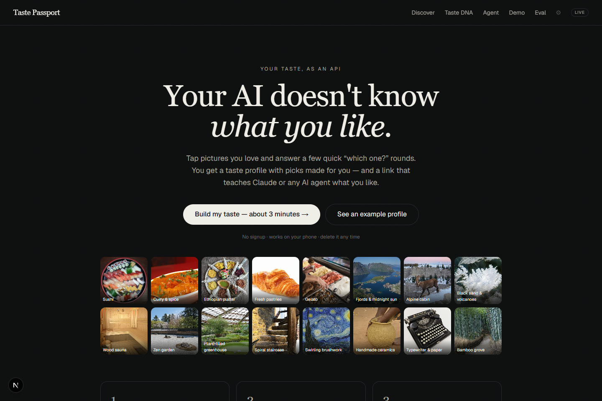
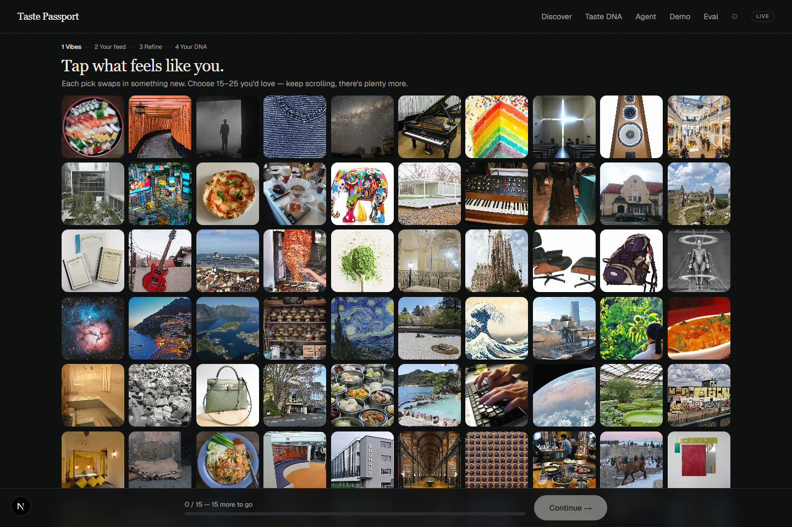
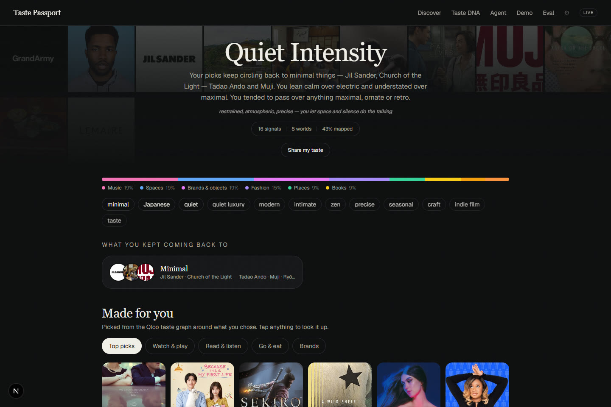
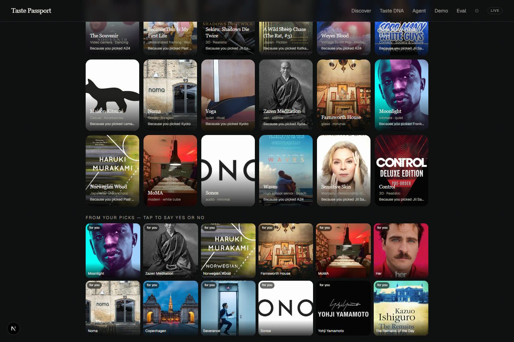
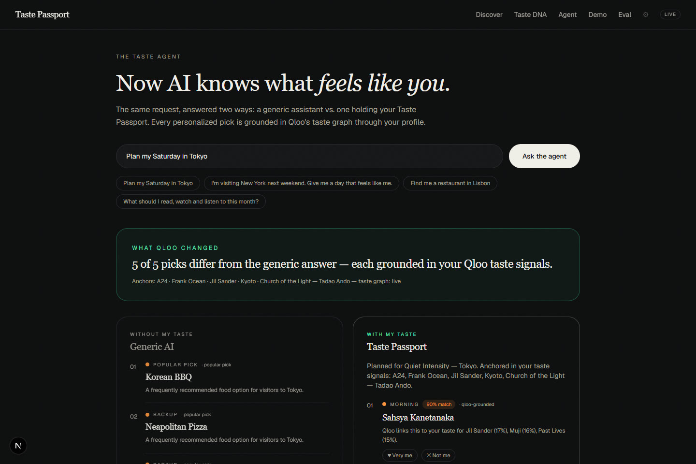
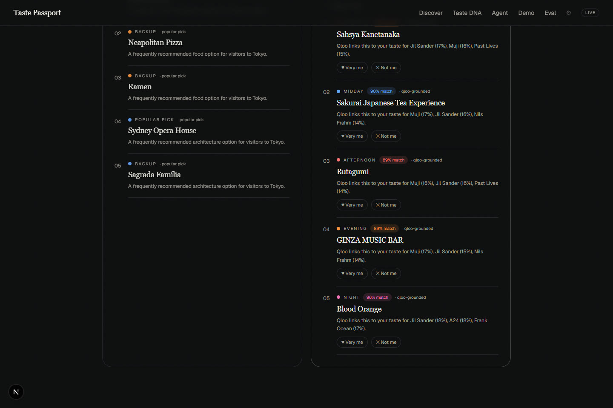

# Taste Passport

> **Teach AI what you love.**
> Your taste. One profile. Every AI.

Taste Passport is a **portable cultural taste layer for AI agents**, built on the
[Qloo taste graph](https://www.qloo.com). Instead of filling out a questionnaire,
you tap pictures you love, then answer a few four-way "which one?" rounds. Every
tap resolves into a real cultural entity, the feed adapts around your emerging
taste (70% exploit / 20% adjacent / 10% novel), and the result is a living **cultural fingerprint** that any AI agent can consume
through a JSON API or an MCP server — so agents stop guessing what you'll love.

```
you → taps & choices → cultural entities → Qloo taste graph
     → adaptive taste model → your cultural fingerprint
     → any AI agent → answers that feel like you
```

**Live:** https://taste-passport-nu.vercel.app · **Demo video:** https://youtu.be/MJW_Jn_pDmM

## Screenshots

| | |
|---|---|
|  |  |
| **Landing**: teach your AI what you like in about 3 minutes | **Vibe wall**: tap people-free photos that feel like you |
|  |  |
| **Taste DNA**: archetype, domain mix and what you kept coming back to | **Made for you**: Qloo picks, each citing the signals behind it |
|  |  |
| **Taste agent**: the same request, generic vs taste-grounded | **Grounded plan**: every pick explained by Qloo affinity |

---

## Why it exists

Agents can reason, plan and execute — but they're culturally blind about *you*.
Ask an agent for "a perfect Saturday" and it gives you the world's most average
Saturday. Taste Passport fixes the input side: before the question is asked, the
agent already holds a structured, explainable model of your cultural taste.

## Why Qloo is essential (not decorative)

Remove Qloo and this product collapses into "visually similar images" — a much
dumber thing. With Qloo, every interaction becomes a **cultural entity signal**:

- **Entity resolution** — each card maps to a real entity (artist, film, brand,
  place, book, game) resolved through Qloo Search in live mode.
- **Cross-domain inference** — liking *Jil Sander* + *Kyoto* + *A24* lets the
  graph surface *kaiseki*, *Ryōan-ji*, ambient piano. Taste transfers across
  domains; that transfer **is** the product.
- **Grounded explanations** — recommendations cite which of your signals Qloo
  linked them to (affinity + explainability contributions), never fabricated.
- In `mock` mode a deterministic local graph (tag affinity + curated cross-domain
  bridges) emulates the same loop so the repo runs with zero credentials. Flip
  `QLOO_MODE=live` with a key and the same adapter talks to the real API.

## How it works

1. **Vibe wall** — an endless wall of people-free photos (dishes, places, rooms,
   textures). Tap 15–25 that feel like you; each pick swaps in something new.
2. **Your feed** — adaptive cards. Each batch is scored and mixed:
   `score = 0.40·qlooAffinity + 0.25·bridgeSimilarity + 0.15·tagSimilarity + 0.10·domainBalance + 0.10·novelty`
   (weights configurable via env), **70% exploitation, 20% adjacent, 10% novelty**.
   Live film/TV/game cards come from Qloo, each domain seeded with its own anchors.
3. **Three chapters of four-way rounds** — *Your instincts* (film, food, books,
   art, TV), *Sports & hobbies*, then *Sharpen*, which aims at whatever we know
   least about. Rounds are built one step ahead on the server, so each reflects
   the choice just made. Questions are concrete ("What's for dinner tonight?"),
   say what they're tuned to ("Tuned to your picks: Ramen & Kaiseki"), and offer
   "None of these". The pick counts strongly (×1.6) and the three passed over
   count lightly against (×0.25), so every answer is *relative*.
4. **Taste state** — likes attract, dislikes repel, with diminishing returns,
   recency weighting and per-domain balancing.
5. **Profile** — archetype (plus a second pull), the *threads* you kept coming back
   to (each with the real picks behind it), hobbies, a five-axis signature, a day
   made for you, and "outside your usual" cross-domain picks. Every sentence names
   things you actually picked.
6. **Made for you** — films, series, games, books, artists, podcasts, places and
   brands from Qloo, plus restaurants and places for *your* hobbies in your city.
   Curated local sections back them up, so it's never empty.
7. **Agent integration** — the Taste Agent answers "plan my Saturday in Tokyo"
   twice, once generically and once grounded in your profile + Qloo, side by side.

### Grounding rules (personalisation without making things up)

- **Anchors, not a bag of likes.** Each Qloo query is seeded from its own world:
  your picks there, real stand-ins for vibe tiles you tapped (the "Hot spring
  steam" tile → *Onsen*), the best local matches in that domain, then your
  strongest picks overall. A mixed bag of everything drifts toward whatever is
  merely popular; per-domain anchors land on Margaret Howell rather than Zara.
- **"Because you picked…"** only ever names something you tapped (vibe stand-ins
  are labelled with the tile you tapped). Our own inferred anchors appear as
  "Close to…", never as your picks. Local reasons require a real overlap of two or
  more tags (or one rare one).
- **No echoes.** A seed card that is the same thing as a vibe you already picked
  (the "Ramen" card after the Ramen tile) is never recommended back to you.

## Architecture

```
app/                       Next.js App Router
  page.tsx                 landing
  discover/                vibe wall → adaptive feed → three chapters of four-way rounds
  profile/                 Taste DNA: threads, signature, day, made-for-you, editor
  agent/                   Taste Agent + "What Qloo changed" comparison
  demo/                    deterministic personas (Maya / Alex)
  dev/                     admin/debug dashboard
  api/
    session                anonymous cookie session
    feed                   adaptive batch selection
    interact               record likes/dislikes (+ strength, + passed-over options)
    taste/rounds           personalised four-way rounds (film/food/…/hobby/auto)
    taste/recommend        made-for-you sections (live Qloo + curated), city-aware
    taste/tweak            boost / remove a pick from the profile
    taste/profile          portable profile (GET) + feedback (POST) + privacy (DELETE)
    taste/explain          grounded "why this matches you"
    agent/plan             Taste Agent (single arm)
    agent/compare          generic vs taste-grounded (the judging moment)
    demo                   persona sessions
    admin/stats            Qloo call metrics, cache, weights
    mcp                    hosted MCP: same 5 tools over HTTP JSON-RPC
    eval                   live evaluation (generic vs taste arms, scored)
    og                     social share card (next/og)
    agent/progress         coarse plan-generation ticks (polled by the UI)
    img                    CC-licensed Wikipedia image resolver (302 + cache)
    cards                  seed catalog
  eval/                    evaluation panel UI
lib/
  qloo/                    adapter (live + mock), TTL cache, metrics
  taste/engine.ts          scoring, exploration, confidence, profile builder
  taste/signals.ts         what you actually picked: anchors, vibe stand-ins, grounded reasons
  taste/rounds.ts          four-way round builder (same kind, different moods)
  taste/recommend.ts       made-for-you sections, re-ranked by your tags
  agent/                   Taste Agent + optional LLM polish + progress ticks
  store/db.ts              sessions: Vercel KV (prod) / JSON file (local), auto
  rate-limit.ts            in-memory token bucket for expensive routes
mcp/server.mjs             MCP stdio server (5 tools)
data/cards.ts              174 curated seed entities, 12 domains
scripts/seed-cards.mjs     seed catalog validator
tests/                     vitest suite (37 tests)
```

## Qloo integration

Live adapter (see `lib/qloo/live.ts`) uses the documented hackathon contract:

| Call | Endpoint |
|---|---|
| Entity search | `GET {QLOO_BASE_URL}/search?query=…&types=…&take=…` |
| Cross-domain recs | `GET {QLOO_BASE_URL}/v2/insights?filter.type=urn:entity:…&signal.interests.entities=…&sort_by=affinity&feature.explainability=true` |
| Tags | `GET {QLOO_BASE_URL}/v2/tags?q=…` |

Auth: `X-Api-Key` header, server-side only — the key never reaches the browser
(enforced by a test). All calls are cached (24h TTL), measured, and degrade
gracefully to the mock graph if Qloo is unavailable. The UI shows a subtle
`mock`/`live` badge.

## Adaptive taste algorithm

- `INTERACTION_WEIGHT`: like +1.0 / dislike −1.0 / skip 0, × diminishing returns
  (per-entity), × recency multiplier (0.8→1.2), so no single swipe dominates.
- Exploration pools: EXPLOIT / ADJACENT / NOVEL, mixed 70/20/10 per batch
  (targets computed, test-enforced), shifting toward exploit as confidence grows.
- Interaction strength (0–2): a four-way choice counts ×1.6; options passed over
  count ×0.25 against (tags only lightly touch the domain, so choosing one film
  over three others never makes you look anti-film).
- Confidence = f(distinct picks, domain coverage, contrast from passed-over options) →
  Learning / Emerging / Strong / High confidence. A product indicator, not a
  scientific accuracy claim.
- Profile versions are stored on every material change (the newest six, slimmed).
- Writes re-read the freshest session right before saving, so a slow feed request
  can never overwrite likes that landed meanwhile; the client also queues its
  writes in order.

## MCP / agent integration

Two ways in, same 5 tools (`get_taste_profile`, `get_taste_context`,
`recommend_for_context`, `explain_taste_match`, `record_feedback`):

```bash
# 1) Hosted (no local install): stateless HTTP JSON-RPC — connect any
#    remote-capable MCP client to the public deployment:
POST /api/mcp?sid=<sessionId>

# 2) Local stdio server talking to any deployment:
TASTE_PASSPORT_URL=http://localhost:3000 \
TASTE_SESSION_ID=<sessionId> \
node mcp/server.mjs
```

No secrets cross the boundary — tools are served from the web API using an
anonymous session id you choose (find yours on `/dev`).

## Local development

```bash
npm install
cp .env.example .env.local   # optional — mock mode needs nothing
npm run dev                  # http://localhost:3000
npx vitest run               # vitest (37 tests)
node scripts/seed-cards.mjs  # validate the seed catalog
```

## Environment variables

See [.env.example](.env.example). Nothing is required to run locally in mock
mode. `QLOO_MODE=live` + `QLOO_API_KEY` enables the real taste graph;
`OPENAI_API_KEY` is optional prose polish only.

## Demo mode

- `/demo` — one click loads **Maya** (quiet-intensity: A24, Frank Ocean, Jil
  Sander, Kyoto) or **Alex** (maximal night-energy: Gucci, Bad Bunny, neon,
  hotpot) as real sessions, then generates genuine profiles.
- `/agent` — run both personas against "Plan my Saturday in Tokyo" and compare.

## Deployment

Any Node host works; it deploys to Vercel as-is.

- **Persistence** — locally, sessions live in a JSON file (`.data/store.json`,
  bounded at 2000 sessions). On Vercel, attach a **KV (Upstash Redis)** store:
  `KV_REST_API_URL` / `KV_REST_API_TOKEN` are injected automatically and
  `lib/store/db.ts` switches over with zero code changes — sessions then
  survive across serverless instances (30-day TTL).
- **Env** — set `QLOO_MODE=live`, `QLOO_API_KEY`, `QLOO_BASE_URL` in the host
  dashboard; never commit `.env*`.
- **Agents over HTTP** — the same 5 MCP tools are reachable on the public URL
  via `POST /api/mcp?sid=<session-id>` (stateless JSON-RPC), so judges can
  connect remote clients without running `mcp/server.mjs` locally. The exact
  connect string is shown on `/dev`.
- **Evaluation** — `/eval` runs 2 personas × 3 scenarios through generic vs.
  taste-grounded arms live and displays personalization / breadth / grounded-pick
  rates.

## Evaluation

`/api/agent/compare` exposes the A/B natively: the same request answered
(A) generically and (C) taste-grounded. The `/dev` dashboard tracks Qloo call
latency, cache hit rate, errors, and current exploration mix. Unit tests pin
the algorithmic contracts (70/20/10 split, no repeats, domain balancing,
diminishing returns, grounded explanations).

## Privacy

Taste is personal. Anonymous cookie sessions, no PII, **Export profile JSON**
and **Clear my profile** controls on the profile page, profiles private by
default, and `DELETE /api/taste/profile` wipes all signals for a session.

## Images & licensing

No copyrighted binaries are committed. Card images resolve at runtime to
Wikipedia thumbnails (CC/public domain) via `/api/img`, which streams bytes
same-origin; live Qloo entities use their own provided images. Cards without an
image get a deterministic generated gradient. MIT license — see [LICENSE](LICENSE).

## Hackathon submission

Built for the [Qloo Agentic Hackathon](https://qloo.devpost.com). See
[docs/HACKATHON.md](docs/HACKATHON.md) for the pitch, demo script, and
judging-criteria mapping.
